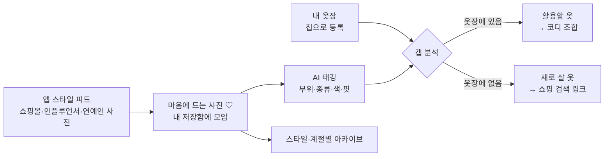

# FULL-JOIN

2026-2 AI캡스톤디자인 5팀
소프트웨어학과 202322021 최정인
소프트웨어학과 202322024 조은재

팀명은 sql의 조인 개념에서 따와 효율적이고 원활한 협업 능력을 키울 수 있도록 하겠다는 포부를 담았습니다.
동시에 팀원의 이름인 조(은재최정)인의 의미도 내포하고 있습니다.

> **설치 없이 휴대폰 브라우저에서 써 볼 수 있어요.** 순서는 [사용 방법](#사용-방법), 직접 실행·테스트는 [실행 방법](#실행-방법)·[테스트 방법](#테스트-방법)을 참고.

---

## 추구미 앱 — 나의 추구미에 빠르게 도달

> **원하는 스타일이 있는 20대 여성이, 그 스타일과 지금 옷장 사이의 거리를 좁히도록 돕는 앱**
>
> 저장한 사진을 AI가 내 옷장과 비교해, 있는 옷으로 입을 코디와 더 살 옷을 알려 준다.

### 문제 상황 및 핵심 숫자

- 인터뷰 대상 **10명 전원**이 스타일 사진을 저장하는 사용자다.
- **10명 중 7명**은 사진을 10장 저장해도 실제로 구매하거나 따라 하는 것은 2장 이하였다. (로그 1·3·4·5·6·7·10)
- **10명 중 7명**은 저장한 사진을 다시 찾는 데 시간이 걸리거나 찾지 못한 경험이 있었다. (로그 1·4·5·6·7·8·9)
- **10명 중 8명**은 사진 속 옷을 찾기 위해 이미지 검색·AI·쇼핑앱 검색 등을 사용하거나, 직접 키워드를 만들어 상품을 탐색했다. (로그 3~10)
- **10명 중 3명**은 저장한 코디를 구현할 때 가진 옷을 먼저 활용하고, 없는 아이템만 새로 찾으려 했다. (로그 6·7·9)
- 일반적인 옷 구매에서는 **10명 전원**이 가진 옷과의 조합을 고려했다. (로그 1~10)
- 설문에서도 여성 **30명 중 27명(90%)**이 옷을 구매할 때 가진 옷과의 매칭을 거의 매번 고민한다고 답했다. 이 결과는 저장 코디 상황의 직접 근거가 아니라 옷장 매칭의 중요성을 보여주는 보조 근거다.

따라서 스타일 사진을 저장한 사용자는 이를 실제 코디로 옮기기 위해 사진을 다시 찾고, 아이템을 해석하고, 가진 옷을 확인하고, 부족한 상품을 별도로 검색해야 한다. 이 과정이 연결되어 있지 않아 저장한 코디를 구체적인 착장과 구매 목록으로 옮기는 작업이 수작업으로 남아 있다.

### 우리 앱의 해결 방식

- 저장한 스타일 사진을 한곳에 모아 다시 찾을 수 있게 한다.
- AI가 사진 속 코디를 개별 아이템으로 분해하고 종류·색 등의 정보를 구조화한다.
- 사진 속 아이템과 사용자가 등록한 옷장을 자동으로 비교한다.
- 각 아이템을 **활용할 옷·비슷한 옷·새로 필요한 옷**으로 구분해 보여준다.
- 새로 필요한 아이템에는 상품 정보 또는 비슷한 상품 검색 경로를 제공한다.
- 이를 통해 사용자가 여러 앱과 옷장을 오가며 수행하던 과정을 한 화면에서 구체적인 착장과 구매 목록으로 정리할 수 있게 한다.

## 사용 방법

> 동료평가(11/11~11/18)로 써 보시는 분을 위한 안내입니다. 처음부터 끝까지 10분쯤 소요됩니다.

### 1. 앱 열기

**https://odit.expo.app**

- 아이폰은 사파리, 갤럭시 같은 안드로이드폰은 크롬으로 여는 것을 권장. 휴대폰 화면 기준으로 만들었고, 노트북 브라우저에서도 접속 가능.
- **앱처럼 쓸 수 있는 방법**
  - 아이폰: 사파리 공유 버튼 → `홈 화면에 추가`
  - 갤럭시: 크롬 오른쪽 위 `⋮` → `홈 화면에 추가` 또는 `앱 설치`
  - 아이폰은 홈 화면 아이콘으로 처음 열면 로그인 화면이 한 번 더 나옴. 같은 닉네임과 숫자를 넣기.
- 첫 화면이 몇 초 걸리면 서버가 로딩 중인 것이니 잠시 기다리거나 새로고침할 것.

### 2. 처음 시작하기

1. **튜토리얼 3장** — 한 브라우저에서 한 번만 나옴.
2. **로그인** — 닉네임(2~12글자)과 숫자 4자리.
   - 처음 쓰는 조합이면 새 계정이 만들어짐. 다른 폰이나 브라우저에서 같은 닉네임과 숫자로 들어오면 같은 계정으로 접속 가능.
   - 다른 사람과 닉네임·숫자가 같으면 계정을 같이 쓰게 됨. 남과 겹치지 않을 닉네임 권장.
   - 진짜 계정 보안이 아니므로 다른 곳에서 쓰는 비밀번호는 넣지 말 것을 권장. 숫자를 잊어버릴 경우 재접속 불가.
3. **내 추구미 고르기** — 스타일 11개 중 마음에 드는 것을 3개까지 고르기. 고른 스타일 사진이 피드에 먼저 노출. `나중에 고를게요`도 가능.
4. **준비 끝** — `옷장에 옷 넣으러 가기`를 누르면 아래 3단계 ①로 바로 이어짐.

### 3. 핵심 흐름 따라 하기

오딧의 핵심은 **저장한 사진 속 옷을 내 옷장과 비교해, 가진 옷으로 되는 것과 새로 필요한 것을 나눠 주는 것**이다.

| 순서 | 어디서 | 무엇을 |
|---|---|---|
| ① 옷장 채우기 | 옷장 탭 → `+ 옷 추가` | 부위·종류 → 색 → 핏을 고르고 `옷장에 넣기`. 상의·하의·신발을 섞어 3~5벌 넣어 보기 |
| ② 사진 보기 | 홈 → `피드` | 사진을 누르면 사진 속 아이템과 쇼핑몰 상품 정보 확인 가능 |
| ③ 내 옷장과 비교 | 사진 화면 → `저장하고 내 옷장과 비교` | 사진 속 옷마다 `활용`·`비슷함`·`필요`로 구분 (아래 표) |
| ④ 고르기 | 결과에서 `비슷함`이 붙은 옷 | `가진 걸로 입기` 또는 `새로 찾기` 선택 |
| ⑤ 옷장 바꿔 보기 | 옷장 탭 | 옷을 더 넣거나 `편집`에서 골라 지운 뒤 ③의 결과를 다시 열면 옷장 새로 반영 |
| ⑥ 물어보기 | 챗봇 탭 | 저장한 사진을 고르고 "내 옷장에서 뭐 입어?", "비슷한 상품 찾아줘"처럼 물어보기 |
| ⑦ 다시 찾기 | 홈 → `모든 저장` | 연도·계절·스타일로 필터링 가능. 계절은 저장한 달 기준(봄 3~5월 · 여름 6~8월 · 가을 9~11월 · 겨울 12~2월) |

- 피드 사진의 저장 버튼은 **저장만** 수행. 저장한 사진은 피드에서 빠지고 `모든 저장`으로 옮겨 감. 거기서 사진을 누르면 ③의 비교 결과를 볼 수 있음.
- 옷장이 비어 있으면 비교 대신 "옷장을 등록하면 가진 옷과 맞춰 드려요"가 나오니 옷 등록을 해 볼 것.

비교 결과표

| 표시 | 뜻 | 예 |
|---|---|---|
| `활용` | 옷장에 같은 종류·같은 색 옷이 있음 | 사진: 블랙 슬랙스 / 옷장: 블랙 슬랙스 |
| `비슷함` | 같은 종류인데 색이 비슷한 계열. 가진 걸로 입을지, 새로 찾을지 사용자가 선택 | 사진: 화이트 셔츠 / 옷장: 아이보리 셔츠 |
| `대체` | 다른 종류인데 색이 같거나 비슷한 계열. 가진 걸로 입을지, 새로 찾을지 사용자가 선택 | 사진: 블랙 니트 / 옷장: 블랙 맨투맨 |
| `필요` | 옷장에 같은 종류가 없거나 색 계열이 다름. 쇼핑몰 상품이나 비슷한 상품 검색 링크를 보여줌 | 사진: 브라운 로퍼 / 옷장: 로퍼 없음 |

> 세 가지를 다 보고 싶으면, 피드 사진 하나를 골라 그 사진 속 옷과 **같은 종류·같은 색** 옷 하나, **같은 종류·비슷한 색** 옷 하나를 옷장에 넣고 비교하는 것을 권장.

### 4. 알아 두면 좋은 것 (지금 MVP 범위)

- **사진 분석은 미리 해 둔 결과** 피드 사진 속 옷(부위·종류·색·핏·스타일)은 사진을 피드에 올릴 때 AI가 분석하고 팀이 확인해 저장해 둔 값임. 앱을 쓸 때마다 AI에게 사진을 새로 전달하지 않는다.
- **활용·비슷함·필요는 정해 둔 규칙으로 나눔.** AI가 그때그때 판단하는 게 아니라 종류와 색 계열을 비교하는 규칙이라, 옷장이 같으면 늘 같은 결과 반환. 핏은 아직 판정에 쓰지 않음.
- **챗봇**은 저장한 사진의 분석 결과와 내 옷장을 근거로 AI가 답변. AI 연결이 안 되면 정해 둔 고정 규칙 답변으로 대체.
- **브랜드·상품명**은 쇼핑몰 상품 정보가 있을 때만 보여줌. 없으면 종류·색으로 만든 비슷한 상품 검색 링크를 보여줌.
- **추천 탭**은 MVP에서는 제외.
- **저장되는 곳:** 옷장과 저장한 사진, 추구미 설정은 서버에 남아서 다른 기기에서도 유지.
- **마이 탭**에서 추구미 다시 고르기, 튜토리얼 다시 보기, 로그아웃 가능.
- 피드 사진은 수업 시연을 위해 쇼핑몰 사진을 임시 사용. 캡처해서 다른 곳에 올리지 않을 것.

### 최종 목표 (최종 평가까지) (중간발표2 이후 삭제 예정)

최종 평가는 단순히 기능이 실행되는지 확인하는 데서 끝내지 않고, **시스템 품질과 실제 사용자 가치가 모두 검증되는지**를 확인한다.

오딧의 기능은 성격에 따라 다음 세 층으로 나누어 평가한다.

1. **Golden Test — 결정론적 기능 검증**
   - 같은 입력에 항상 같은 결과가 나와야 하는 규칙 기반 기능
   - 예: 활용·비슷함·대체·필요 판정, 코디 구성 규칙, 출력 스키마

2. **Offline Evals — 확률적 AI 품질 평가**
   - 실행마다 결과가 달라질 수 있는 AI 기능
   - 예: 스타일 사진 태깅, 챗봇 답변, 추천 설명 품질

3. **Online Metrics — 실제 사용자 행동 평가**
   - 최종 버전을 실제 사용자가 사용하면서 핵심 가치에 도달했는지 측정
   - 예: Activation, Core Value Reach, Decision, 재방문

평가 결과는 최초 측정값을 baseline으로 저장하고, 기능·프롬프트·모델을 수정한 뒤 동일한 기준으로 다시 측정한다. 단순히 기능을 추가했다는 사실이 아니라 **변경 전후 지표가 실제로 개선되었는지**를 최종 결과로 사용한다.

---

### 1. 정량적 평가

#### 1-1. Golden Test — 결정론적 기능

현재 `활용 / 비슷함 / 대체 / 필요` 판정은 AI가 임의로 판단하는 것이 아니라 종류·색 계열·대체 규칙에 따라 결정되므로, AI 정확도 지표가 아니라 **결정론적 회귀 테스트**로 평가한다.

| 평가 항목 | 측정 방법 | 목표 |
|---|---|---:|
| **Gap 판정 규칙 통과율** | 사진 아이템과 옷장 조합별 기대 `활용/비슷함/필요` 결과와 실제 결과 비교 | **100%** |
| **대체 규칙 통과율** | 가까운 종류 + 색 조건을 만족할 때만 `대체` 후보가 생성되는지 검사 | **100%** |
| **코디 제약 준수율** | 생성된 코디가 실제 옷장 item만 사용하고 동일 item을 중복 사용하지 않는지 검사 | **100%** |
| **빈 옷장 처리 통과율** | 옷장이 비었을 때 모든 아이템을 구매로 단정하지 않고 안내 상태를 반환하는지 검사 | **100%** |
| **회귀 케이스 통과율** | 이전 테스트·사용자 평가에서 발견되어 수정한 실패 케이스 재실행 | **100%** |

결정론적 규칙은 한 건의 실패도 정상 동작으로 보기 어렵기 때문에 최종 버전에서는 **100% 통과를 배포 기준**으로 한다.

---

#### 1-2. Offline Evals — AI 시스템 품질

AI 품질 평가는 일반적인 모델 성능이 아니라 **오딧의 실제 제품 태스크**를 기준으로 수행한다.

평가 데이터셋은 정상 케이스뿐 아니라 사진이 애매한 경우, 아이템이 없는 사진, 근거가 부족한 경우, 모호한 질문 등 실패·경계 케이스를 포함한다.

최종 평가에서는 MVP 기준으로 **50개 이상의 평가 케이스** 확보를 목표로 하며, 실제 사용 과정에서 발견된 실패 케이스는 회귀 케이스로 추가한다.

##### 스타일 사진 AI 태깅

| 평가 항목 | 측정 방법 | 채점기 | 목표 |
|---|---|---|---:|
| **출력 형식 준수율** | 결과가 지정된 JSON schema와 enum을 모두 만족하는지 검사 | Code Rule | **100%** |
| **아이템 속성 정확도** | 사람이 라벨링한 `slot`, `kind`, `color`와 AI 출력 비교 | Exact Match / Code | **≥ 90%** |
| **근거 없는 브랜드·상품 생성** | 캡션·이미지 글자·검증된 상품정보에 없는 브랜드/상품명을 생성했는지 검사 | Code Rule | **0건** |
| **비의류 사진 환각** | 풍경·음식 등 옷이 없는 사진에서 아이템을 생성했는지 검사 | Code Rule | **0건** |
| **태스크 성공률** | 오류나 파싱 실패 없이 최종 구조화 결과를 반환한 비율 | Code Rule | **≥ 95%** |

`visual_fit`처럼 사람도 판단이 애매할 수 있는 항목은 별도 세부 지표로 기록하되, 핵심 태깅 정확도는 `slot`, `kind`, `color`를 중심으로 평가한다.

##### 챗봇 및 AI 설명 품질

| 평가 항목 | 측정 방법 | 채점기 | 목표 |
|---|---|---|---:|
| **옷장 근거 준수율** | 실제 옷장에 없는 옷을 "가지고 있는 옷"이라고 말한 경우 검사 | Code Rule | **100%** |
| **상품/브랜드 환각률** | 근거가 없는 상품명·브랜드를 실제 정보처럼 생성한 비율 | Code Rule | **0건** |
| **근거 충실도 (Faithfulness)** | 답변이 저장된 사진 분석 결과와 사용자 옷장 정보로 뒷받침되는지 평가 | LLM-as-a-Judge | **≥ 90%** |
| **설명 품질** | 추천·비교 이유가 사용자 조건 및 실제 데이터와 논리적으로 연결되는지 평가 | LLM-as-a-Judge | **≥ 80%** |
| **응답 성공률** | 오류 없이 정상 답변을 반환한 비율 | Code Rule | **≥ 95%** |
| **응답 지연시간** | 성공 응답의 평균 및 p95 latency 측정 | 로그 | **지속 기록 및 개선** |

코드로 판단할 수 있는 형식·존재 여부·제약 조건은 LLM Judge에 맡기지 않는다.  
LLM-as-a-Judge는 **설명 품질이나 근거 연결성처럼 코드로 판정하기 어려운 항목에만 사용**한다.

Judge 평가는 다음과 같이 좁고 명확한 rubric을 사용한다.

| 점수 | 설명 품질 기준 |
|---:|---|
| **5** | 실제 사진 분석·옷장 정보를 근거로 추천 이유가 명확하고 논리적으로 연결됨 |
| **3** | 결론은 타당하지만 근거 설명이 일부 누락되거나 불명확함 |
| **1** | 사용자 데이터와 모순되거나 근거 없이 결론을 생성함 |

최종 집계에서는 **4~5점을 Pass**로 간주한다.

---

#### 1-3. Online Metrics — 실제 사용자 행동

Offline Evals가 시스템 자체의 품질을 측정한다면, Online Metrics는 **실제 사용자가 오딧의 핵심 가치를 경험했는지** 확인한다.

평가 기간 동안 모든 행동은 `user_id`, `session_id`, 이벤트 로그를 이용해 측정한다.

##### 핵심 사용자 가치 지표

| 지표 | 정의 | 확인하려는 것 |
|---|---|---|
| **Activation Rate** | `옷장 5벌 이상 + 사진 저장 1회 이상 + 비교 결과 확인 1회 이상`을 모두 달성한 사용자 비율 | 단순 접속을 넘어 핵심 사용 흐름까지 실제로 사용했는가 |
| **Core Value Reach Rate** | 전체 사용자 중 `result_view`를 1회 이상 경험한 사용자 비율 | "스타일 사진 ↔ 내 옷장 비교"라는 핵심 가치를 경험했는가 |
| **Time to Core Value** | 첫 로그인부터 첫 비교 결과까지 걸린 시간의 median | 핵심 기능까지 도달하는 과정이 지나치게 길지 않은가 |
| **Decision Rate** | 비교 결과 이후 `가진 옷 활용 / 새로 찾기 / 쇼핑 링크` 중 하나의 행동을 한 사용자 비율 | 결과가 단순 정보 제시에 그치지 않고 실제 판단으로 이어지는가 |
| **Repeat Core Value Rate** | 서로 다른 날짜에 비교 결과를 2회 이상 확인한 사용자 비율 | 핵심 기능 자체에 반복 사용할 가치가 있는가 |
| **Revisit Rate** | 평가 기간 중 서로 다른 날짜에 2일 이상 활동한 사용자 비율 | 일회성 체험이 아니라 다시 사용할 이유가 있는가 |

##### UX 진단 지표

다음 지표는 최종 성공 KPI라기보다 **핵심 지표가 낮은 이유를 찾기 위한 진단 지표**로 사용한다.

- 단계별 Funnel Drop-off
  - 로그인 → 추구미 → 옷장 등록 → 사진 저장 → 비교 → 의사결정
- 화면별 체류시간
  - `screen_leave.duration_ms`의 median / p95
- 화면별 앱 이탈
  - `app_background`
- 옷 등록 완료율 및 단계별 이탈률
- 힌트 노출 → 클릭 → 실제 목표 행동 전환율
- 피드 추천 유형별 상세 진입률·저장률
- 비교 및 챗봇 요청의 실패율·latency

---

#### 1-4. 개선 전후 비교

정량평가는 최종 점수 한 번만 측정하지 않는다.

각 주요 개선 전후에 동일한 평가 세트와 사용자 행동 지표를 비교하여 실제 개선 여부를 확인한다.

예:

```text
Baseline
Gap 관련 회귀 테스트 통과율 92%
AI 태깅 정확도 81%
Core Value Reach Rate 55%

        ↓ 실패 케이스 분석

종류 오분류 개선
다음 행동 안내 개선

        ↓ 재평가

Final
Gap 관련 회귀 테스트 통과율 100%
AI 태깅 정확도 91%
Core Value Reach Rate 72%
```

확률적 AI 지표는 한 번의 실행 결과에만 의존하지 않고, 가능한 경우 **3회 이상 반복 실행한 평균값**을 사용한다.

작은 평가 세트에서 1~2건 차이로 발생한 변화는 즉시 개선으로 단정하지 않고, 실패 케이스 원문을 함께 검토한다.

---

### 2. 정성적 평가

정성평가는 UI의 단순한 호불호보다 **오딧이 처음 정의한 문제를 실제로 해결했는지**를 확인하는 데 초점을 둔다.

사용 종료 후 인터뷰 또는 자유서술 피드백을 통해 다음 항목을 평가한다.

| 평가 영역 | 확인할 내용 | 질문 예시 |
|---|---|---|
| **문제 해결성** | 저장한 코디를 실제 착장으로 옮기는 과정이 기존보다 쉬워졌는가 | "평소 저장한 코디를 실제로 입으려고 할 때와 비교해서 어떤 점이 달라졌나요?" |
| **핵심 가치 이해** | 사용자가 오딧의 목적을 의도한 대로 이해했는가 | "이 앱이 어떤 앱이라고 생각하나요?" |
| **의사결정 도움** | 무엇을 활용하고 무엇을 새로 찾아야 할지 결정하기 쉬워졌는가 | "비교 결과가 실제로 입을 옷이나 살 옷을 결정하는 데 도움이 됐나요?" |
| **보유 옷 활용 가치** | 새 옷을 구매하기 전에 자신의 옷장을 활용하는 데 도움이 되었는가 | "가진 옷으로 대체해서 입을 수 있다는 정보가 유용했나요?" |
| **추천·결과 신뢰성** | 활용·비슷함·대체·필요 판정과 AI 설명이 납득되는가 | "결과를 믿기 어렵거나 실제 옷장과 다르다고 느낀 순간이 있었나요?" |
| **결과 이해도** | 별도 설명 없이 결과 상태와 다음 행동을 이해할 수 있는가 | "활용·비슷함·대체·필요의 차이를 바로 이해할 수 있었나요?" |
| **옷장 등록 부담** | 초기 옷장 입력 비용이 이후 얻는 가치에 비해 감수 가능한가 | "옷을 등록하는 과정은 이후 기능을 쓰기 위해 할 만한 수준이었나요?" |
| **추구미 기반 피드 가치** | 피드가 자신의 취향과 관련 있다고 느끼는가 | "추구미를 고른 뒤 피드가 내 취향에 맞는다고 느꼈나요?" |
| **기존 방식 대비 가치** | Pinterest·Instagram·쇼핑앱·GPT 등을 따로 사용하는 것보다 나은 점이 있는가 | "기존 방식 대신 이 앱을 사용할 이유가 있다고 느꼈나요?" |
| **재사용 의향** | 실제 생활에서 다시 사용할 상황이 떠오르는가 | "앞으로 어떤 상황에서 다시 사용할 것 같나요?" |
| **잔존 문제** | 최종 버전에서도 가장 크게 남은 문제가 무엇인가 | "한 가지만 바꿀 수 있다면 무엇을 바꾸고 싶나요?" |

정성 평가는 단순 만족도 점수만으로 결론 내리지 않고, **사용자가 실제로 한 행동과 함께 해석**한다.

예를 들어 사용자가 "비교 기능이 유용했다"고 답했더라도 실제 로그에서 비교 결과 이후 아무 행동도 하지 않았다면 이를 그대로 성공 사례로 단정하지 않는다. 반대로 Decision Rate가 낮다면 사용자 인터뷰를 통해 결과를 신뢰하지 못했는지, 다음 행동이 불명확했는지 원인을 확인한다.

두 명 이상의 사용자가 같은 문제를 반복해서 언급한 경우 공통 문제로 분류하고, 개별 사례는 후속 개선 후보로 기록한다.

---

### 3. 최종발표에서 사용할 핵심 지표

최종발표에서는 모든 지표를 동일한 비중으로 보여 주지 않고 다음 항목을 중심으로 결과를 정리한다.

#### 시스템 품질

1. **AI 태깅 정확도**
2. **형식 및 제약 준수율**
3. **환각/근거 없는 정보 발생 건수**
4. **Faithfulness 및 설명 품질**
5. **회귀 테스트 통과율**

#### 사용자 가치

1. **Activation Rate**
2. **Core Value Reach Rate / Time to Core Value**
3. **Decision Rate**
4. **Repeat Core Value Rate**
5. **Revisit Rate**

최종 결과는 아래 구조로 설명한다.

```text
문제 발견
→ Offline Evals / Online Metrics로 수치 확인
→ 실패 케이스와 사용자 피드백 분석
→ 기능·프롬프트·UX 수정
→ 동일한 기준으로 재평가
→ 개선 전후 수치 비교
```

최종 목표는 단순히 "기능이 구현되었다"가 아니라,

> **AI 시스템이 충분한 품질로 동작하며, 실제 사용자가 저장한 스타일을 자신의 옷장과 연결해 착장·구매 판단까지 이어갈 수 있음을 정량·정성 데이터로 검증하는 것**

이다.

### 5. 피드백 남기기

써 보시면서 좋았던 점, 불편했던 점, 이렇게 바뀌면 좋겠다 싶은 점을 동료평가 양식에 편하게 적어 주시면 감사하겠습니다.

오류가 났다면 **어느 화면에서 무엇을 눌렀는지** 같이 알려 주세요. 화면 캡처까지 있으면 더 감사합니다.

써 주셔서 고맙습니다!

## 테스트 방법

### 써 보면서 확인하기

| 해 볼 것 | 이렇게 나오면 정상 |
|---|---|
| 옷장이 빈 채로 저장한 사진의 비교 결과 열기 | "옷장을 등록하면 가진 옷과 맞춰 드려요" |
| 사진 속 옷과 같은 종류·같은 색 옷을 옷장에 넣고 비교 | 그 옷에 `활용` |
| 같은 종류·비슷한 색(예: 화이트와 아이보리) 옷을 넣고 비교 | `비슷함`과 `가진 걸로 입기`·`새로 찾기` 버튼 |
| 다른 종류(예: 니트와 맨투맨)·같거나 비슷한 색 옷을 넣고 비교 | `대체`와 `가진 걸로 입기`·`새로 찾기` 버튼 |
| 그 옷을 옷장에서 지우고 비교 결과 다시 열기 (같은 종류 옷이 더 없을 때) | `필요`와 쇼핑 링크로 바뀜 |
| 피드에서 사진의 저장 버튼 누르기 | 피드에서 빠지고 `모든 저장`에 나옴 |
| 로그아웃 후 다른 기기에서 같은 닉네임·숫자로 로그인 | 옷장과 저장한 사진이 그대로 |

## 코드 테스트

저장소 루트에서:

```bash
npm ci
npm run check
```

- 갭 분석·수용 기준 골든 테스트 47개([`tests/harness/golden_cases.yaml`](tests/harness/golden_cases.yaml)), 서버 계약 테스트, 타입 검사를 한 번에 돌려요. 마지막에 `fail 0`이 나오면 통과예요.
- 앱 코드 검사는 `cd mobile` 후 `npm run typecheck`, `npm run lint`예요.

## 발견 → 정의 → 명세 (중간평가① 발표 순서)

| 순서 | 문서 | 한 줄 |
|---|---|---|
| 1 | [인터뷰 분석](docs/research/interviews.md) | 인터뷰 10건(전부 녹음 전사 확인), 페인 8개, 핵심 Job Story, 가설 판정 |
| 2 | [미니 온톨로지](docs/ontology.yaml) | 클래스 6개 — User, StyleImage, Item, WardrobeItem, Product, Outfit. 모든 항목에 로그 번호 |
| 3 | [문제 정의서](docs/PROBLEM.md) | 가진 옷과 맞출 확신이 없어 구매 포기·방치. 설문 근거, 반증 조건 두 층 |
| 4 | [제품 스펙](docs/SPEC.md) | 핵심 기능: 사진 태깅 → 옷장 대조(갭 분석) → 코디 조합 + 쇼핑 링크. 수용 기준(AC), 핵심 3개(AC9·AC11·AC2)는 인터뷰 근거 표 포함 |
| 5 | [스파이크](docs/spikes/README.md) | 안 되면 앱이 성립하지 않는 것: 구조화 출력(사진 → 스키마 형식) |
| 6 | [Evals](evals/README.md) | 핵심 기능(태깅·옷장 대조)이 기본 성능을 내는지 계속 재는 기준 (정확도, 지어내기 0건, 형식·속도) |
| — | [AGENTS.md](AGENTS.md) | 용어집과 절대 규칙 (규칙마다 대응 AC 번호) |
| — | [출력 스키마](src/fulljoin/schemas/style_image.schema.json) · [분석 프롬프트](src/fulljoin/prompts/parse_query.md) | 사진 → 태깅 결과의 형식 계약(보기 목록)과 실패 모드 점검표 (강의 3, 보기 목록은 팀 확정 전 후보안) |

## 핵심 흐름



## 근거 역추적 예시

`로그 9 "제 옷장에 있는 걸 최대한 찾아서 이제 그거를 이용을 하려는 편이어서 … 입고 싶은 옷이 있으면 그냥 비슷한 옷으로"` → 페인 3 (매칭을 머릿속으로) → 온톨로지 `Item.gap_status (활용/비슷함/구매)` → PROBLEM 증거 "가진 옷을 먼저 활용하고 없을 때 산다" → SPEC **AC9** (옷장과 대조해 활용/비슷함/구매 분류)

핵심 스펙 3개(AC9·AC11·AC2)가 어떻게 나왔는지는 [SPEC 3절](docs/SPEC.md) 표에 정리했다.

## MVP 서버 개발

서버는 단일 Supabase Edge Function `api`와 Postgres 마이그레이션으로 구성한다. 상세 요청·응답과 현재 데모 제한은 [`docs/API_MVP.md`](docs/API_MVP.md)에 있다.

### 준비

1. Node.js 22.18 이상과 Supabase CLI, Docker 호환 런타임을 설치한다.
2. `.env.example`을 참고해 로컬 전용 `.env`를 만든다. 실제 service-role 키·OpenAI 키·분석 관리자 토큰은 커밋하지 않는다.
3. 프로젝트 루트에서 `supabase start`와 `supabase db reset`을 실행한다.
4. `supabase functions serve api --env-file .env`로 API를 실행한다.

로컬 함수 기본 주소는 `http://127.0.0.1:54321/functions/v1/api`다.

```bash
curl http://127.0.0.1:54321/functions/v1/api/health
```

### 검증

```bash
npm ci
npm run check
```

`npm run check`는 승인된 하네스 해시, 분석 계약 동기화, 문법, TypeScript, 골든 계약 47개, 서버 계약 테스트를 차례로 검사한다. Supabase 통합 검증은 로컬 스택을 실행한 뒤 별도로 수행한다.

피드 JPG와 Google Sheets CSV 일괄 등록 방법은 [`docs/API_MVP.md`](docs/API_MVP.md#사진-분석과-csv-일괄-등록)를 따른다. 기본 실행은 검증 전용이며 `--apply`를 명시해야 외부 서비스에 반영된다.
