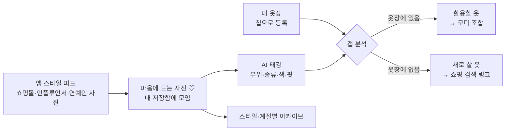

# FULL-JOIN

2026-2 AI캡스톤디자인 5팀
소프트웨어학과 202322021 최정인
소프트웨어학과 202322024 조은재

팀명은 sql의 조인 개념에서 따와 효율적이고 원활한 협업 능력을 키울 수 있도록 하겠다는 포부를 담았습니다.
동시에 팀원의 이름인 조(은재최정)인의 의미도 내포하고 있습니다.

> **설치 없이 휴대폰 브라우저에서 바로 써 볼 수 있어요.** 순서는 [사용 방법](#사용-방법), 직접 실행·테스트는 [실행 방법](#실행-방법)·[테스트 방법](#테스트-방법)에 있어요.

---

## 추구미 앱 — 나의 추구미에 빠르게 도달

> **원하는 스타일이 있는 20대 여성이, 그 스타일과 지금 옷장 사이의 거리를 좁히도록 돕는 앱**
>
> 저장한 사진을 AI가 내 옷장과 비교해, 있는 옷으로 입을 코디와 더 살 옷을 알려 준다.

### 핵심 숫자

- 인터뷰 **10명 전원**이 옷을 살 때 가진 옷과 어울릴지를 **머릿속으로만** 맞춰 본다
- **10명 중 9명**이 맞춰 보지 못한 채 산 옷을 방치한 적이 있다 (가진 옷과의 조합·핏·무드가 안 맞아서)
- 그 결과 **저장한 사진 10장 중 실제로 사거나 따라 하는 건 1~2장** (10명 중 7명)
- 설문(여성 30명): 90%가 옷을 살 때 가진 옷과의 매칭을 "거의 매번" 고민

## 사용 방법

> 동료평가(11/11~11/18)로 써 보시는 분을 위한 안내예요. 처음부터 끝까지 10분쯤 걸려요.

### 1. 앱 열기

**https://odit.expo.app**

- 아이폰은 사파리, 갤럭시 같은 안드로이드폰은 크롬으로 여세요. 휴대폰 화면 기준으로 만들었고, 노트북 브라우저에서도 열려요.
- **홈 화면에 추가하면 앱처럼 쓸 수 있어요.**
  - 아이폰: 사파리 공유 버튼 → `홈 화면에 추가`
  - 갤럭시: 크롬 오른쪽 위 `⋮` → `홈 화면에 추가` 또는 `앱 설치`
  - 아이폰은 홈 화면 아이콘으로 처음 열면 로그인 화면이 한 번 더 나와요. 같은 닉네임과 숫자를 넣으면 옷장은 그대로예요.
- 첫 화면이 몇 초 걸리면 서버가 깨어나는 중이에요. 잠시 기다리거나 새로고침해 주세요.

### 2. 처음 시작하기

1. **소개 3장** — 앱이 하는 일을 보여 줘요. `건너뛰기`도 돼요. 한 브라우저에서 한 번만 나와요.
2. **로그인** — 닉네임(2~12글자)과 숫자 4자리를 정해요.
   - 처음 쓰는 조합이면 새 옷장이 만들어져요. 다른 폰이나 브라우저에서 같은 닉네임과 숫자로 들어오면 같은 옷장이 열려요.
   - 다른 사람과 닉네임·숫자가 같으면 옷장을 같이 쓰게 돼요. 남과 겹치지 않을 닉네임을 써 주세요.
   - 진짜 계정 보안이 아니에요. 다른 곳에서 쓰는 비밀번호는 넣지 마세요. 숫자를 잊으면 그 옷장은 다시 찾을 수 없어요.
3. **내 추구미 고르기** — 스타일 11개 중 마음에 드는 것을 3개까지 골라요. 고른 스타일 사진이 피드에 먼저 나와요. `나중에 고를게요`도 돼요.
4. **준비 끝** — `옷장에 옷 넣으러 가기`를 누르면 아래 3단계 ①로 바로 이어져요.

### 3. 핵심 흐름 따라 하기

오딧의 핵심은 **저장한 사진 속 옷을 내 옷장과 비교해, 가진 옷으로 되는 것과 새로 필요한 것을 나눠 주는 것**이에요. 아래 순서대로 해 보세요.

| 순서 | 어디서 | 무엇을 |
|---|---|---|
| ① 옷장 채우기 | 옷장 탭 → `+ 옷 추가` | 부위·종류 → 색 → 핏을 고르고 `옷장에 넣기`. 사진은 안 찍어도 돼요. 상의·하의·신발을 섞어 3~5벌 넣어 보세요 |
| ② 사진 보기 | 홈 → `피드` | 사진을 누르면 사진 속 아이템과 쇼핑몰 상품 정보가 나와요 |
| ③ 내 옷장과 비교 | 사진 화면 → `저장하고 내 옷장과 비교` | 사진 속 옷마다 `활용`·`비슷함`·`대체`·`필요`가 붙고, 아래에 내 옷으로 맞춘 코디가 나와요 (아래 표) |
| ④ 고르기 | 결과에서 `비슷함`·`대체`가 붙은 옷 | `가진 걸로 입기` 또는 `새로 찾기`를 눌러 봐요. 고른 대로 아래 코디가 바뀌어요 |
| ⑤ 옷장 바꿔 보기 | 옷장 탭 | 옷을 더 넣거나 `편집`에서 골라 지운 뒤 ③의 결과를 다시 열면 결과가 바뀌어요 |
| ⑥ 물어보기 | 챗봇 탭 | 저장한 사진을 고르고 "내 옷장에서 뭐 입어?", "비슷한 상품 찾아줘"처럼 물어봐요 |
| ⑦ 다시 찾기 | 홈 → `모든 저장` | 저장한 사진만 모여 있어요. 연도·계절·스타일로 골라 볼 수 있어요. 계절은 저장한 달 기준이에요(봄 3~5월 · 여름 6~8월 · 가을 9~11월 · 겨울 12~2월) |

- 피드 사진의 저장 버튼은 **저장만** 해요. 저장한 사진은 피드에서 빠지고 `모든 저장`으로 옮겨 가요. 거기서 사진을 누르면 ③의 비교 결과가 열려요.
- 옷장이 비어 있으면 비교 대신 "옷장을 등록하면 가진 옷과 맞춰 드려요"가 나와요. ①을 먼저 해 주세요.

비교 결과는 이렇게 읽어요.

| 표시 | 뜻 | 예 |
|---|---|---|
| `활용` | 옷장에 같은 종류·같은 색 옷이 있어요 | 사진: 블랙 슬랙스 / 옷장: 블랙 슬랙스 |
| `비슷함` | 같은 종류인데 색이 비슷한 계열이에요. 가진 걸로 입을지, 새로 찾을지 골라요 | 사진: 화이트 셔츠 / 옷장: 아이보리 셔츠 |
| `대체` | 같은 종류는 없지만 같은 자리에 입는 가까운 종류(예: 니트↔맨투맨)가 같은 색·비슷한 색으로 있어요. 가진 걸로 입을지, 새로 찾을지 골라요 | 사진: 아이보리 니트 / 옷장: 아이보리 맨투맨 |
| `필요` | 같은 종류도, 대체할 옷도 없어요. 무신사·에이블리·지그재그 검색 링크를 보여 줘요 | 사진: 브라운 로퍼 / 옷장: 로퍼 없음 |

> 네 가지를 다 보고 싶으면, 피드 사진 하나를 골라 그 사진 속 옷과 **같은 종류·같은 색** 옷 하나, **같은 종류·비슷한 색** 옷 하나, **가까운 종류·같은 색** 옷 하나(예: 사진이 니트면 맨투맨)를 옷장에 넣고 비교해 보세요.
>
> 아래 `내 옷장으로 입어 보기`는 사진 속 옷 자리를 내 옷으로 채운 코디예요. 자리마다 활용 → 비슷함 → 대체 순서로 넣고, 같은 자리에 넣을 옷이 여러 벌이면 코디가 최대 3개까지 나와요.

### 4. 알아 두면 좋은 것 (지금 MVP 범위)

- **사진 분석은 미리 해 둔 결과예요.** 피드 사진 속 옷(부위·종류·색·핏·스타일)은 사진을 피드에 올릴 때 AI가 분석하고 팀이 확인해 저장해 둔 값이에요. 앱을 쓸 때마다 AI가 사진을 새로 보지 않아요.
- **활용·비슷함·대체·필요는 정해 둔 규칙으로 나눠요.** AI가 그때그때 판단하는 게 아니라 종류와 색 계열을 비교하는 규칙이라, 옷장이 같으면 늘 같은 결과가 나와요. `대체`로 보는 가까운 종류 짝은 팀이 정한 표(`src/fulljoin/outfit.ts`)를 따라요. 핏은 아직 판정에 쓰지 않아요.
- **챗봇**은 저장한 사진의 분석 결과와 내 옷장을 근거로 AI가 답해요. AI 연결이 안 되면 정해 둔 규칙 답변으로 대신해요.
- **브랜드**는 쇼핑몰 상품 정보가 있을 때만 보여 주고, 상품은 `이 상품 보기`로 열어요. 없으면 종류·색으로 만든 비슷한 상품 검색 링크를 보여 줘요.
- **추천 탭**은 아직 준비 중이에요.
- **저장되는 곳:** 옷장과 저장한 사진은 서버에 남아서 다른 기기에서도 그대로예요. 고른 추구미만 그 브라우저에 저장돼요.
- **마이 탭**에서 추구미 다시 고르기, 튜토리얼 다시 보기, 로그아웃을 할 수 있어요.
- 피드 사진은 수업 시연을 위해 쇼핑몰 사진을 임시로 쓰고 있어요. 캡처해서 다른 곳에 올리지 말아 주세요.

### 5. 피드백 남기기

써 보시면서 좋았던 점, 불편했던 점, 이렇게 바뀌면 좋겠다 싶은 점을 동료평가 양식에 편하게 적어 주세요. 전부 읽어 보고 다음 업데이트에 반영할게요.

오류가 났다면 **어느 화면에서 무엇을 눌렀는지** 같이 알려 주세요. 화면 캡처까지 있으면 저희가 같은 상황을 다시 만들어 보기 쉬워서 더 빨리 고칠 수 있어요.

써 주셔서 고맙습니다!

## 실행 방법

| 방법 | 언제 | 필요한 것 |
|---|---|---|
| A. 웹 링크 | 써 보기만 할 때 (동료평가) | 휴대폰이나 노트북 브라우저 |
| B. 앱을 내 컴퓨터에서 | 앱 코드를 보거나 고쳐 볼 때 | Node.js 22.18 이상 |
| C. 서버까지 내 컴퓨터에서 | 서버 코드를 고쳐 볼 때 | Node.js 22.18 이상, Supabase CLI, Docker |

**A. 웹 링크** — [사용 방법](#사용-방법) 1단계의 주소를 열면 돼요. 설치할 것이 없어요.

**B. 앱을 내 컴퓨터에서 실행**

```bash
git clone https://github.com/jeong35/FULL-JOIN.git
cd FULL-JOIN/mobile
npm install
npx expo start
```

- 터미널에 메뉴가 나오면 `w`(브라우저), `i`(아이폰 시뮬레이터, Xcode 필요) 중 하나를 누르거나, 휴대폰의 Expo Go로 QR 코드를 찍어요.
- 따로 설정하지 않으면 배포된 서버에 붙어서 실제 피드·옷장 데이터로 동작해요.
- 써 볼 때는 `w`(브라우저)를 추천해요. 브라우저는 로그인 화면부터 나오고, 시뮬레이터·Expo Go는 로그인 없이 팀 시연용 계정으로 바로 들어가요.
- 설정 값과 자주 생기는 문제는 [`mobile/README.md`](mobile/README.md)에 있어요.

**C. 서버까지 내 컴퓨터에서 실행** — 아래 [MVP 서버 개발](#mvp-서버-개발) 순서를 따라요.

- 로컬 데이터베이스는 비어 있어서 피드 사진을 직접 등록해야 해요([`docs/API_MVP.md`](docs/API_MVP.md#사진-분석과-csv-일괄-등록)).
- 사진 분석과 챗봇 AI를 쓰려면 본인 OpenAI 키가 필요해요. 키는 커밋하지 않는 `.env`에만 넣어요.
- 서버 요청·응답 형식은 [`docs/API_MVP.md`](docs/API_MVP.md)에 있어요.

## 테스트 방법

### 써 보면서 확인하기

| 해 볼 것 | 이렇게 나오면 정상 |
|---|---|
| 옷장이 빈 채로 저장한 사진의 비교 결과 열기 | "옷장을 등록하면 가진 옷과 맞춰 드려요" |
| 사진 속 옷과 같은 종류·같은 색 옷을 옷장에 넣고 비교 | 그 옷에 `활용` |
| 같은 종류·비슷한 색(예: 화이트와 아이보리) 옷을 넣고 비교 | `비슷함`과 `가진 걸로 입기`·`새로 찾기` 버튼 |
| 그 옷을 옷장에서 지우고 비교 결과 다시 열기 (같은 종류 옷이 더 없을 때) | `필요`와 쇼핑 링크로 바뀜 |
| 사진 속 옷과 가까운 종류·같은 색 옷(예: 니트 사진에 아이보리 맨투맨)을 넣고 비교 | `대체`, 코디에 그 옷이 `대체` 표시로 들어감. `새로 찾기`를 누르면 코디의 그 자리가 `필요`와 쇼핑 링크로 바뀜 |
| 피드에서 사진의 저장 버튼 누르기 | 피드에서 빠지고 `모든 저장`에 나옴 |
| 로그아웃 후 다른 기기에서 같은 닉네임·숫자로 로그인 | 옷장과 저장한 사진이 그대로 |

### 코드 테스트

저장소 루트에서:

```bash
npm ci
npm run check
```

- 갭 분석·수용 기준 골든 테스트 47개([`tests/harness/golden_cases.yaml`](tests/harness/golden_cases.yaml)), 서버 계약 테스트, 타입 검사를 한 번에 돌려요. 마지막에 `fail 0`이 나오면 통과예요.
- 앱 코드 검사는 `cd mobile` 후 `npm run typecheck`, `npm run lint`예요.

## 발견 → 정의 → 명세 (중간평가① 발표 순서)

| 순서 | 문서 | 한 줄 |
|---|---|---|
| 1 | [인터뷰 분석](docs/research/interviews.md) | 인터뷰 10건(전부 녹음 전사 확인), 페인 8개, 핵심 Job Story, 가설 판정 |
| 2 | [미니 온톨로지](docs/ontology.yaml) | 클래스 6개 — User, StyleImage, Item, WardrobeItem, Product, Outfit. 모든 항목에 로그 번호 |
| 3 | [문제 정의서](docs/PROBLEM.md) | 가진 옷과 맞출 확신이 없어 구매 포기·방치. 설문 근거, 반증 조건 두 층 |
| 4 | [제품 스펙](docs/SPEC.md) | 핵심 기능: 사진 태깅 → 옷장 대조(갭 분석) → 코디 조합 + 쇼핑 링크. 수용 기준(AC), 핵심 3개(AC9·AC11·AC2)는 인터뷰 근거 표 포함 |
| 5 | [스파이크](docs/spikes/README.md) | 안 되면 앱이 성립하지 않는 것: 구조화 출력(사진 → 스키마 형식) |
| 6 | [Evals](evals/README.md) | 핵심 기능(태깅·옷장 대조)이 기본 성능을 내는지 계속 재는 기준 (정확도, 지어내기 0건, 형식·속도) |
| — | [AGENTS.md](AGENTS.md) | 용어집과 절대 규칙 (규칙마다 대응 AC 번호) |
| — | [출력 스키마](src/fulljoin/schemas/style_image.schema.json) · [분석 프롬프트](src/fulljoin/prompts/parse_query.md) | 사진 → 태깅 결과의 형식 계약(보기 목록)과 실패 모드 점검표 (강의 3, 보기 목록은 팀 확정 전 후보안) |

## 핵심 흐름



## 근거 역추적 예시

`로그 9 "제 옷장에 있는 걸 최대한 찾아서 이제 그거를 이용을 하려는 편이어서 … 입고 싶은 옷이 있으면 그냥 비슷한 옷으로"` → 페인 3 (매칭을 머릿속으로) → 온톨로지 `Item.gap_status (활용/비슷함/구매)` → PROBLEM 증거 "가진 옷을 먼저 활용하고 없을 때 산다" → SPEC **AC9** (옷장과 대조해 활용/비슷함/구매 분류)

핵심 스펙 3개(AC9·AC11·AC2)가 어떻게 나왔는지는 [SPEC 3절](docs/SPEC.md) 표에 정리했다.

## MVP 서버 개발

서버는 단일 Supabase Edge Function `api`와 Postgres 마이그레이션으로 구성한다. 상세 요청·응답과 현재 데모 제한은 [`docs/API_MVP.md`](docs/API_MVP.md)에 있다.

### 준비

1. Node.js 22.18 이상과 Supabase CLI, Docker 호환 런타임을 설치한다.
2. `.env.example`을 참고해 로컬 전용 `.env`를 만든다. 실제 service-role 키·OpenAI 키·분석 관리자 토큰은 커밋하지 않는다.
3. 프로젝트 루트에서 `supabase start`와 `supabase db reset`을 실행한다.
4. `supabase functions serve api --env-file .env`로 API를 실행한다.

로컬 함수 기본 주소는 `http://127.0.0.1:54321/functions/v1/api`다.

```bash
curl http://127.0.0.1:54321/functions/v1/api/health
```

### 검증

```bash
npm ci
npm run check
```

`npm run check`는 승인된 하네스 해시, 분석 계약 동기화, 문법, TypeScript, 골든 계약 47개, 서버 계약 테스트를 차례로 검사한다. Supabase 통합 검증은 로컬 스택을 실행한 뒤 별도로 수행한다.

피드 JPG와 Google Sheets CSV 일괄 등록 방법은 [`docs/API_MVP.md`](docs/API_MVP.md#사진-분석과-csv-일괄-등록)를 따른다. 기본 실행은 검증 전용이며 `--apply`를 명시해야 외부 서비스에 반영된다.
